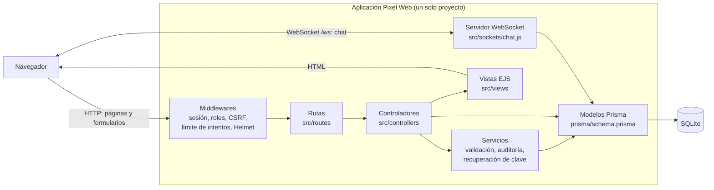
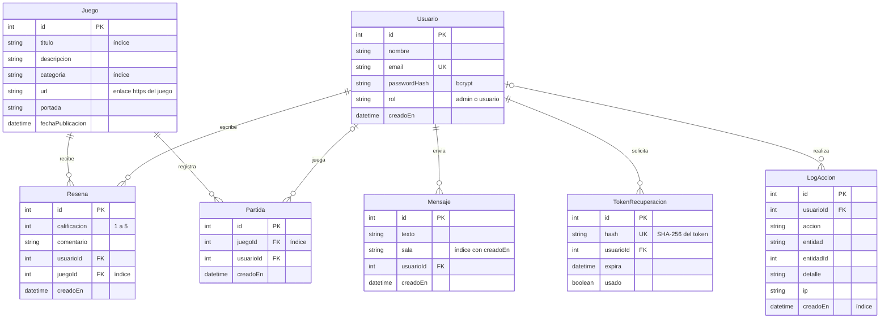

# Pixel Web

Proyecto de la materia Aplicaciones Web Avanzadas (EPN). Primer bimestre: aplicación web monolítica.

## Descripción de la PYME y del problema

**Pixel Web** es una pyme ficticia de desarrollo de videojuegos ubicada en Quito. Crea juegos cortos para navegador y los ofrece gratis.

**Problema.** Cada juego vive en un enlace distinto. Los jugadores no tienen un lugar donde descubrirlos, la empresa no recibe opiniones sobre ellos y no hay un espacio para que la comunidad converse. Además, publicar, cambiar o retirar un juego no queda registrado en ningún lado.

**Solución.** Una aplicación web que reúne los juegos en un solo catálogo, donde:

- Los jugadores se registran, eligen un juego y lo juegan dentro de la misma página.
- Cada jugador puede calificar y reseñar los juegos.
- Los usuarios conversan en tiempo real en un chat de comunidad.
- El administrador agrega, edita y elimina juegos desde un panel propio.
- Cada acción importante queda registrada en una auditoría.

## Stack

| Capa | Tecnología |
|---|---|
| Servidor y rutas | Node.js 20 + Express 5 |
| Vistas renderizadas en el servidor | EJS, HTML5, CSS3 y JavaScript |
| Tiempo real | WebSocket con la librería `ws`, en el mismo servidor HTTP |
| Base de datos | SQLite con Prisma ORM |
| Seguridad | bcryptjs (hash con sal), express-session, Helmet, token CSRF, express-rate-limit |
| Correo | Nodemailer (SMTP) |
| Pruebas | Jest y Supertest |

## Pasos para ejecutar

Requisitos: Node.js 20 o superior y npm.

```bash
# 1. Instalar dependencias (también genera el cliente de Prisma)
npm install

# 2. Crear el archivo de variables de entorno
cp .env.example .env        # en Windows: copy .env.example .env

# 3. Crear la base de datos
npx prisma db push

# 4. Cargar el administrador y los juegos de ejemplo
npm run seed

# 5. Iniciar la aplicación
npm run dev
```

La aplicación queda en `http://localhost:3000`.

- **Administrador:** entra con `ADMIN_EMAIL` y `ADMIN_PASSWORD` del archivo `.env`.
- **Jugador:** crea una cuenta desde la pantalla de registro.
- **Recuperación de clave:** si las variables `SMTP_*` están configuradas, el enlace llega por correo. Si no, el envío se simula y el enlace aparece en la consola del servidor.

Para ejecutar las pruebas automatizadas:

```bash
npm test
```

## Variables de entorno

Están en el archivo [`.env.example`](.env.example). El archivo `.env` real no se sube al repositorio.

| Variable | Descripción | Valor de ejemplo |
|---|---|---|
| `PORT` | Puerto del servidor | `3000` |
| `DATABASE_URL` | Ubicación de la base de datos SQLite | `file:./dev.db` |
| `SESSION_SECRET` | Secreto para firmar la cookie de sesión. Debe ser largo y aleatorio | `cambia-esto-por-un-valor-largo-y-aleatorio` |
| `NODE_ENV` | Entorno. En `production` la cookie de sesión solo viaja por HTTPS | `development` |
| `APP_URL` | URL pública de la aplicación. Se usa en el enlace de recuperación de clave | `http://localhost:3000` |
| `ADMIN_EMAIL` | Correo del administrador que crea el seed | `admin@pixel-web.local` |
| `ADMIN_PASSWORD` | Clave del administrador que crea el seed | `Admin12345` |
| `SMTP_HOST` | Servidor de correo para la recuperación de clave. Vacío: el correo se simula en consola | `smtp.gmail.com` |
| `SMTP_PORT` | Puerto del servidor de correo | `587` |
| `SMTP_USER` | Cuenta que envía los correos | `tu-correo@gmail.com` |
| `SMTP_PASS` | Clave de esa cuenta. En Gmail, una contraseña de aplicación | |
| `MAIL_FROM` | Remitente que ve el usuario | `Pixel Web <tu-correo@gmail.com>` |

## Diagramas

### Arquitectura del monolito (MVC)

Todo vive en un solo proyecto desplegable: las vistas se renderizan en el servidor, el enrutamiento lo resuelve Express y el servidor WebSocket comparte el mismo servidor HTTP.



### Modelo de datos



Restricciones del esquema:

- `Usuario.email` y `TokenRecuperacion.hash` son únicos.
- Un usuario solo puede reseñar un juego una vez: restricción única sobre `Resena (usuarioId, juegoId)`.
- Al eliminar un juego se eliminan sus reseñas y partidas.
- Al eliminar un usuario se eliminan sus reseñas, mensajes y tokens. Sus partidas y sus registros de auditoría se conservan sin usuario.

El esquema completo está en [`prisma/schema.prisma`](prisma/schema.prisma).

## Integrantes y roles

| Integrante | Rol | Versión | Responsabilidad |
|---|---|---|---|
| Samira Fernanda Arízaga Guallpa | Arquitecta de datos | v1 (`main`) | Esquema de Prisma, seed y documentación del modelo de datos. |
| Paúl Andrés Dávila Navarrete | Ingeniero de seguridad y acceso | v2 (`Feature_Autenticacion`) | Registro, inicio de sesión, recuperación de clave, sesiones y roles. |
| Isabella Sarahy Hernández Quintana | Desarrolladora full stack | v3 (`Feature_Catalogo`) | Catálogo, página de juego, reseñas, CRUD del panel de administración y auditoría. |
| Gregory Leandro Salazar Domínguez | Ingeniero de sistemas en tiempo real | v4 (`Feature_Chat`) | Servidor WebSocket, historial del chat, usuarios conectados y notificaciones. |
| Alison Betancourt | Líder de calidad y DevSecOps | v5 (`Feature_Seguridad`) | Helmet, límite de intentos, pruebas automatizadas, medición de rendimiento y README. |

## Uso de IA

| Herramienta | Propósito |
|---|---|
| Claude (Anthropic) | Generar la base del código: modelos, controladores, rutas, vistas, servidor WebSocket, validaciones y pruebas. Diseñar los estilos y las portadas en pixel art de los juegos. Redactar borradores de las descripciones de los juegos, de este README con sus diagramas y de la presentación. |

**Aporte del equipo:** la idea de la pyme y los cinco juegos, hechos en Desarrollo de Juegos Serios. Las decisiones del sistema: arquitectura MVC, WebSocket nativo, roles, panel de administración, auditoría y reseñas. La revisión, las pruebas y la integración por ramas.

El grupo revisó, probó y entiende el código y los textos generados, y puede explicarlos y modificarlos durante la defensa.
